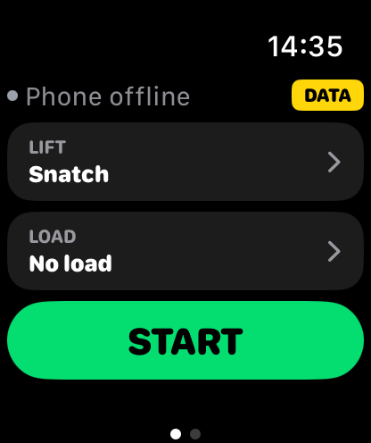
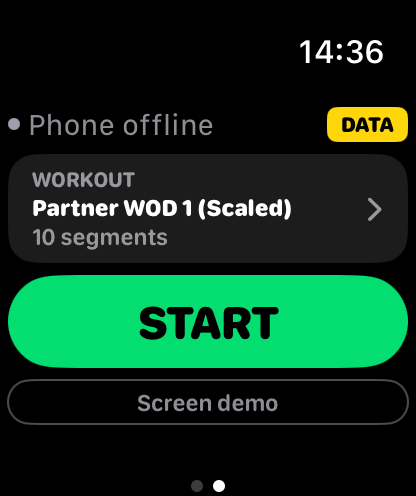
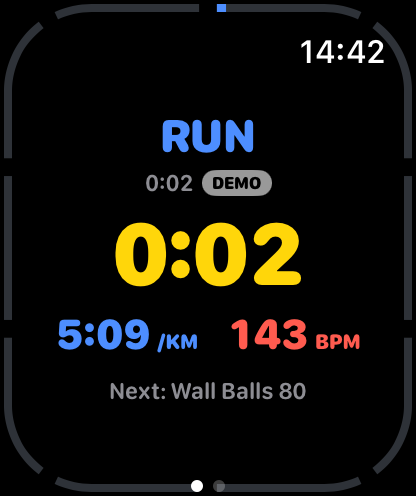
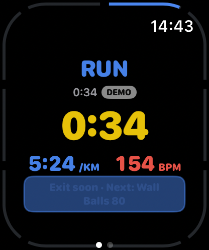

# Watch design: the one we keep

The owner approved the current watch design on 2 Nov 2026 ("this is the right watch face").
Screenshots below are the real app from `main` / TestFlight build 1, on an Apple Watch
46 mm simulator, Workouts › Screen demo (fake data, nothing saved).

**Rule:** don't change the look or layout of any watch screen as a side effect of other
work (merges, phone colour schemes, UX drafts, refactors). New watch items follow this
style, and the owner sees them before they are built. In merge conflicts on
`Watch/*.swift`, keep the existing look.

| Screen | What it shows |
|---|---|
|  | **Lifting start page.** Phone status, DATA badge, LIFT and LOAD cards, big green START. |
|  | **Workouts start page** (swipe left). Workout card (name, segments), START, Screen demo. |
|  | **Running workout.** Station name large in its colour, station time, big yellow clock, pace (blue), heart rate (red), next station, race progress border around the edge. |
|  | **Same screen 34 s later.** The border fills as the race moves on; the next line becomes a framed "Exit soon · Next" banner. |

Part of the same design but not captured here (the simulator has no Crown): other
stations' colours, the Crown arc on the border, round position (R4 2/4), the NOW flash
after each switch, the time-cap alert, the controls page (End), the dimmed wrist-down
screen with live clocks, and the lifting session screens.
